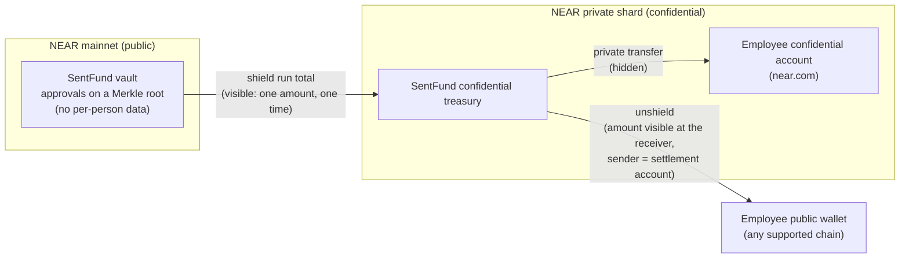
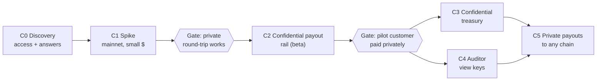

# SentFund roadmap: confidential payroll with NEAR Confidential Intents

> **SentFund note (Phase 26):** copied from the milestone kit of 12 Nov 2026, unchanged except relative links. The kit was written without seeing SentFund: check it against [milestone-1-gap-analysis.md](milestone-1-gap-analysis.md). Links to the kit's reference code (`contracts/vault-guard`, `services/`, `db/migrations`, `test-vectors/`) do not resolve: that code is deliberately not in this repository.

*As of 12 Nov 2026 · Draft for the SentFund team*

## In one paragraph

Today every SentFund payout amount is public on NearBlocks, which blocks any company that pays real salaries. NEAR Confidential Intents (generally available since 7 Jul 2026) runs transfers on a private shard, so amounts and counterparties stay off the public chain. Our plan has three steps. First, prove that it works with a small mainnet spike. Then ship a **confidential payout rail** for pilot customers. Then move the whole treasury onto the private shard once NEAR confirms we can deploy there. Auditor access (view keys) follows when NEAR ships it. This runs alongside milestones 1 to 3. Milestone 1 ("Safe to pilot") has to land first, because confidential payouts depend on its MPC signer and payout commitments.

---

## 1. What Confidential Intents gives us, and what it doesn't

| | Detail | Source |
|---|---|---|
| **Status** | Generally available since 7 Jul 2026, through the existing 1Click API with a "confidential" parameter. No separate SDK. | [NEAR blog](https://www.near.org/blog/announcing-general-availability-of-confidential-intents) |
| **Hidden** | Inside the private shard: sender, amounts and routing. NEAR's wording is that order size, timing, counterparties and strategy are not publicly visible. | [LeoDex](https://leodex.io/editorial/near-confidential-intents-july-2026), [NEAR blog](https://www.near.org/blog/announcing-general-availability-of-confidential-intents) |
| **Still visible** | Deposits into and withdrawals out of the shard, because those land on public chains. Payouts to public wallets look like ordinary transfers from a bridge or solver account. Matching timing and amounts at these public edges can still reveal information. The design is "confidential, not anonymous". | [LeoDex](https://leodex.io/editorial/near-confidential-intents-july-2026) |
| **Trust model** | A permissioned validator set and a TEE-secured bridge to NEAR mainnet. No independent audit had been published as of July 2026. | [LeoDex](https://leodex.io/editorial/near-confidential-intents-july-2026) |
| **Compliance** | NEAR says assets are screened when they enter the shard. LeoDex calls this screening layer SHIELD and says the system is deliberately not a mixer. | [NEAR blog](https://www.near.org/blog/announcing-general-availability-of-confidential-intents), [LeoDex](https://leodex.io/editorial/near-confidential-intents-july-2026) |
| **View keys** | Each account gets a view key it can share with an auditor for a limited time. In July 2026 NEAR said it "plans to roll out" this, so it was not live then. **Check the current status before Phase C4.** | [NEAR blog](https://www.near.org/blog/announcing-general-availability-of-confidential-intents) |
| **Integration** | The confidential contract is `intents.far` (the public one is `intents.near`). Private asset ids take the form `imt:<treasury>:<public_id>`. Moving funds in is a "shield" step, and moving them out is a burn that "unshields" them. Requests need a partner JWT. | [NEAR Intents docs](https://docs.near-intents.org/integration/market-makers/confidential-example) |
| **Precedent** | Trezu runs **confidential multisig treasuries** on the private shard. Members and votes are public; balances, proposals and payments are private. Payments go either to near.com confidential accounts (staying inside the shard) or to public wallets (bridged out, with the settlement account shown as the sender). Its deposit addresses are single-use and valid for 72 hours. | [Trezu docs](https://docs.trezu.org/confidential-treasuries) |
| **Testnet** | None of the sources mention a testnet. **Assume mainnet only.** SentFund's tUSDC can't be used, so the spike needs real USDC in small amounts. | — |

**Biggest design consequence:** salary amounts stay private only if the employee receives into a confidential account. If we pay to a public wallet, the link to SentFund is broken, but the amount still shows up on the employee's own address.

---

## 2. Target design

### Three ways to get there

| Option | How it works | What the public sees | Who enforces "pay only what was approved" | Status |
|---|---|---|---|---|
| **A. Confidential payout rail** | The vault stays public and approves a Merkle root, as in milestone 1. On release, it shields the run total into a SentFund confidential account, and an operator then pays each approved row privately. | Run total and time at shield. Nothing per person, except amounts received at public wallets. | The **operator key**, held in MPC. Inside the shard, the contract checks are not available yet. Reconciliation against the root catches mistakes after the fact. | Possible today with 1Click |
| **B. Confidential treasury** | The vault and multisig themselves live on the private shard, as Trezu does. | Members and votes only. | **The contract**, as in milestone 1, but private. | Needs NEAR to allow our contract on the shard: **open question** |
| **C. Hybrid (recommended path)** | Ship A for pilots with tight limits, and move to B when NEAR confirms. | As A, then as B. | MPC operator plus limits and reconciliation, then the contract. | — |

**Why C:** A can be built now, using primitives we already have from milestone 1: Merkle commitments, the MPC signer and spending limits. B is the end state, but it depends on NEAR.

---

## 3. Phases

### C0. Discovery (1 week, can start now)

**Goal:** remove the unknowns before we build anything.

- [ ] Submit the NEAR Intents integration form and get a **partner JWT** (1Click and the relay both require one).
- [ ] Ask the NEAR team the [open questions](#5-open-questions-for-the-near-team) below, especially testnet access and custom contracts on the shard.
- [ ] List the assets enabled for confidential mode. Confirm USDC and USDT on NEAR, and which chains we can unshield to.
- [ ] Legal and compliance: confirm that confidential payouts work with the shard's ingress screening, our own screening (milestone 1, F6) and Travel Rule duties in pilot markets.
- [ ] Read Trezu's confidential treasury docs end to end, and talk to their team if possible. They are the closest precedent.

**Exit:** written answers to the open questions, plus a JWT in hand.

### C1. Spike (1–2 weeks)

**Goal:** prove a full private round-trip with real money, keeping amounts under $20 in total.

- [ ] Shield USDC from a SentFund-owned mainnet account into a confidential balance through 1Click.
- [ ] Make a private transfer to a test employee's near.com confidential account. Confirm on NearBlocks that the amount and recipient **do not** appear.
- [ ] Unshield to a public wallet on NEAR and on one other chain. Record exactly what a public observer sees: sender, amount, timing.
- [ ] Measure fees, time to settle and the failure modes: an expired deposit address, a partial fill, recovery.
- [ ] Write up a one-page "what an outsider can see" note, for sales and for customers.

**Exit (Gate 1):** a private round-trip works, and we can describe its visibility precisely.

### C2. Confidential payout rail, beta (4–6 weeks; needs milestone 1 done)

**Goal:** a pilot customer runs payroll where per-person amounts are not public.

- [ ] A per-run **confidential mode** toggle (admin setting, off by default).
- [ ] On release, the vault transfers exactly the run total to the shielding step. The amount is capped by the milestone 1 per-run limit.
- [ ] Use a **payout operator** whose key is held in MPC or multisig (from milestone 1) and who can only act for released runs. It pays the rows from the approved file, using the same Merkle proofs as milestone 1.
- [ ] **Reconciliation job:** prove that the sum of private transfers equals the shielded total, with one transfer per approved row. Any mismatch freezes the vault (milestone 1 guardian freeze) and alerts admins.
- [ ] **Employee onboarding:** help employees open a near.com confidential account. Let them choose "confidential account" (fully private) or "public wallet" (link to SentFund broken, but their own amount visible). Explain the difference in one screen.
- [ ] **Approver UI:** show that a run is confidential, and show what will be public (run total and time).
- [ ] **Runbook:** a stuck shield, an expired deposit address, an operator outage. Use the recover path from the docs.

**Exit (Gate 2):** a pilot customer has paid one run privately, reconciliation is exact, and no per-person amounts are visible for employees on confidential accounts.

### C3. Confidential treasury (4–8 weeks; depends on NEAR)

**Goal:** move enforcement back on-chain, inside the shard.

- [ ] Deploy the vault logic (approvals, limits, payee registry, Merkle-verified payouts) on the private shard, if NEAR allows custom contracts there. Otherwise, consider building on Trezu's treasury contracts if they offer an integration.
- [ ] Retire the operator's broad role. Execution becomes permissionless again, as in milestone 1.
- [ ] Decide what stays public: Trezu leaves members and votes visible, so our approver identities would be too.

**Exit:** balances, approvals and payments are private, and the contract, not an operator, enforces "pay only what was approved".

### C4. Auditor view keys (2–3 weeks once NEAR ships them)

- [ ] An **auditor role** that receives a time-limited view key for the company's confidential account.
- [ ] **Exports:** per-run payout reports, generated from the confidential data, that an auditor can match against the on-chain Merkle root.
- [ ] **Employee self-service:** each employee can share their own view key with a tax advisor.

### C5. Private payouts to any chain (ties to the "any chain, any stablecoin" feature)

- [ ] The employee picks a chain and token. SentFund unshields to that chain through 1Click, and the employee sees the expected visibility before choosing.

---

## 4. How this lines up with the product milestones

| Product milestone | Confidential track | Why the order matters |
|---|---|---|
| **M1 Safe to pilot** (now) | C0 Discovery, C1 Spike | C2 needs M1's MPC signer, Merkle commitments, spending limits and freeze. |
| **M2 Private and flexible** | C2 Confidential payout rail | This is the "Confidential payroll" item in the M2 plan. |
| **M3 Enterprise-wide** | C3 Confidential treasury, C4 Auditor view keys, C5 Private payouts to any chain | These depend on NEAR's timeline. |

---

## 5. Open questions for the NEAR team

1. Is there a **testnet** or sandbox for Confidential Intents? If not, can partners get a fee-free mainnet allowance for testing?
2. Can a third party **deploy its own contract** on the private shard, as Trezu's multisig treasuries do? What review is required?
3. What is the **timeline for view keys** (time-scoped auditor access)? Will there be an API for issuing and revoking them?
4. Which **assets and chains** are enabled for confidential transfers and for unshielding? Is there an endpoint that lists them?
5. What exactly is **visible at the edges** when shielding from a NEAR contract account and unshielding to a public wallet: sender, memo, amount?
6. What are the **rate and size limits** per partner and per transfer? What are the fees?
7. What is the **status of audits** of the private shard, TEE attestation and the bridge? Is there a security contact?
8. How does **ingress screening** (SHIELD) treat a payroll operator who sends hundreds of small transfers? Can we register as a known business?

---

## 6. Risks

| Risk | Impact | Mitigation |
|---|---|---|
| No testnet | Spike and QA cost real money; mistakes are real | Cap spike funds; use a dedicated mainnet account with low limits; dry-run everything on testnet with the public rail first |
| Operator key in Option A can misdirect private payouts | Loss inside one run | MPC operator, per-run cap, exact reconciliation, guardian freeze, move to C3 |
| Edge metadata (run total and timing at shield) | Competitors can estimate payroll size | Split shields across runs or time windows (C2 follow-up); disclose clearly |
| Trust in permissioned validators and TEEs; no audit published as of July 2026 | Customer security reviews may push back | Publish our own threat model; track NEAR's audit status; keep the public rail as a fallback |
| View keys late | Auditors can't verify private payouts | Interim: signed per-run reports from SentFund plus the on-chain Merkle root |
| Regulation of privacy-preserving payments differs by market | Some pilots can't use it | Confidential mode stays opt-in, per company and per market |

## Sources

- [NEAR: Announcing General Availability of Confidential Intents](https://www.near.org/blog/announcing-general-availability-of-confidential-intents)
- [NEAR Intents docs: Confidential example](https://docs.near-intents.org/integration/market-makers/confidential-example)
- [Trezu docs: Confidential treasuries](https://docs.trezu.org/confidential-treasuries)
- [LeoDex: NEAR Confidential Intents, how private swaps work](https://leodex.io/editorial/near-confidential-intents-july-2026). A builder's editorial, so treat its claims with care.
- [NEAR docs: NEAR Intents in 2026 (Chain Signatures, 1Click)](https://docs.near.org/blog/2026-01-24-near-intents-2026)
