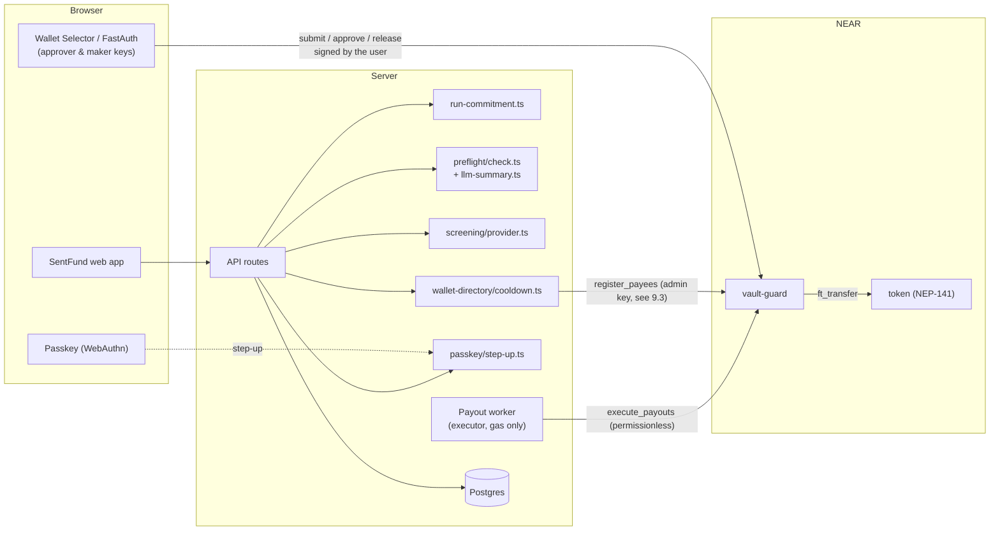
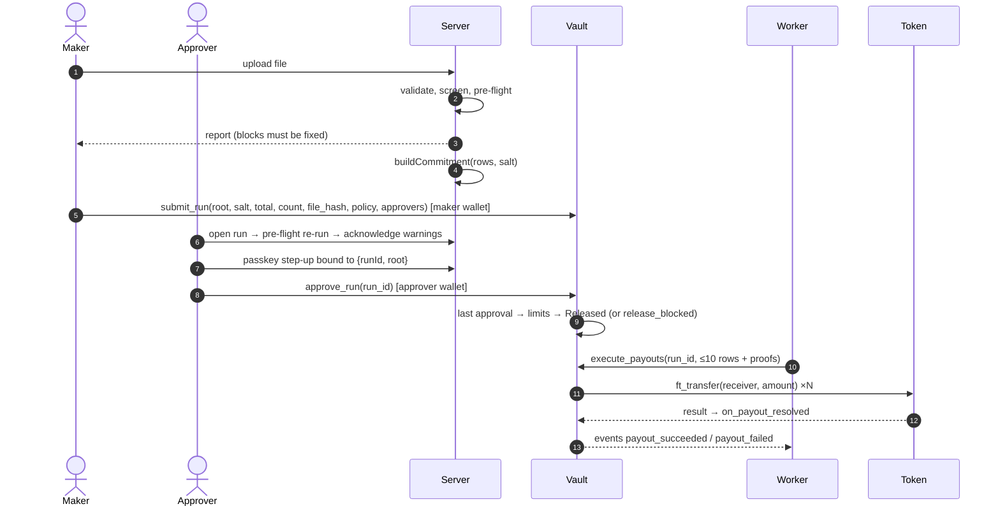
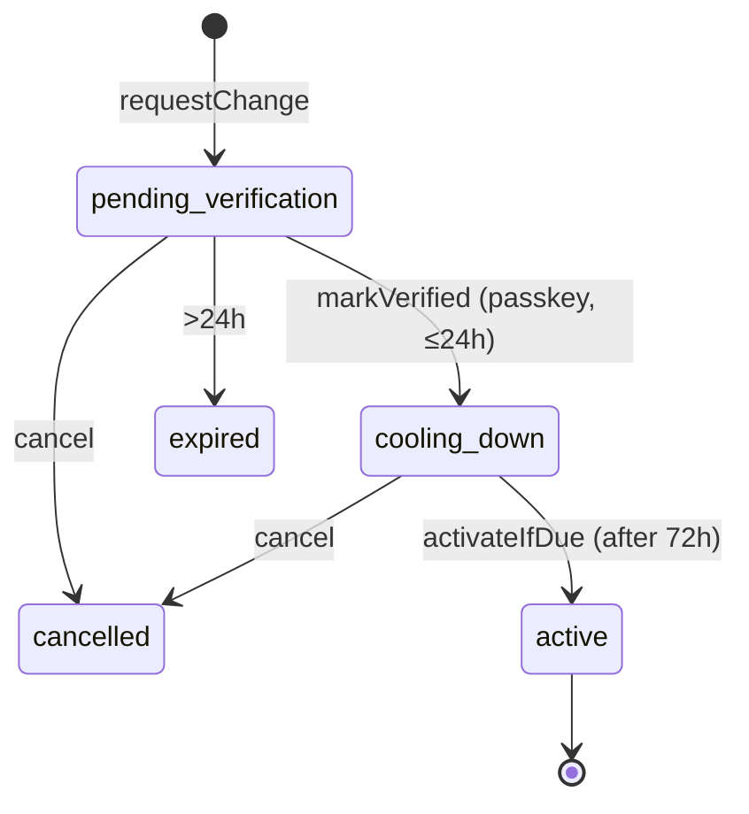

# Tech spec: Milestone 1, "Safe to pilot"

> **SentFund note (Phase 26):** copied from the milestone kit of 12 Nov 2026, unchanged except relative links. The kit was written without seeing SentFund: check it against [milestone-1-gap-analysis.md](milestone-1-gap-analysis.md). Links to the kit's reference code (`contracts/vault-guard`, `services/`, `db/migrations`, `test-vectors/`) do not resolve: that code is deliberately not in this repository.

*Companion to the [PRD](prd-milestone-1-safe-to-pilot.md). Reference code lives in this kit: [`contracts/vault-guard`](../contracts/vault-guard), [`services/src`](../services/src) and [`db/migrations`](../db/migrations).*

## 1. Architecture



**Main change from today:** user actions are signed by the users' own keys. The only server key left calls `execute_payouts`, which is safe by design. The admin key for `register_payees` is covered in §9.3.

## 2. Contract: `vault-guard`

Source: [`contracts/vault-guard/src/lib.rs`](../contracts/vault-guard/src/lib.rs). It uses near-sdk 5.30 and has 29 unit tests (`cargo test`).

### 2.1 Methods

| Method | Caller | Checks | Effect |
|---|---|---|---|
| `new(owner, tokens, policy)` | deployer | policy valid | init |
| `set_role(account_id, role, enabled)` | owner | — | grants or revokes Admin, Maker, Approver or Guardian |
| `set_policy(policy)` | owner | policy valid | replaces the limits (applies to future releases and payouts) |
| `set_token(token, allowed)` | owner | — | token allow-list |
| `freeze(reason)` | guardian or owner | — | `frozen = true` |
| `unfreeze()` | owner | — | `frozen = false` |
| `register_payees(accounts)` | admin | — | new wallets become payable at `now + payee_activation_delay_ns`; existing wallets are unchanged |
| `remove_payee(account_id)` | admin | — | wallet can no longer be paid |
| `submit_run(args)` | maker | not frozen; token allowed; `1 ≤ recipient_count ≤ 10,000`; total ≤ per-run max; root not used before; approvers count matches policy; approvers distinct, hold the Approver role and ≠ maker | stores the run as `Submitted` and returns `run_id` |
| `approve_run(run_id)` | designated approver | not frozen; status `Submitted`; not the maker; not already approved; sequential order | adds approval; on the last approval, `Approved`, then auto-release for `One` / `TwoSequential` |
| `reject_run(run_id, reason)` | designated approver | status `Submitted` or `Approved` | `Rejected` |
| `cancel_run(run_id)` | maker | status `Submitted` or `Approved` | `Cancelled` |
| `release_run(run_id)` | maker | not frozen; status `Approved`; limits | `Released` (needed for `TwoParallel`, or to retry a blocked release) |
| `execute_payouts(run_id, items ≤ 10)` | **anyone** | not frozen; `Released`; each row: index in range, unpaid, amount ≤ per-recipient max, payee registered and active, proof valid, cumulative ≤ total | marks the row paid, sends `ft_transfer` + callback; `Completed` when all rows are paid |
| `on_payout_resolved(...)` | self (callback) | `#[private]` | on failure, un-marks the row and goes back to `Released` |
| Views | anyone | — | `get_run`, `is_paid`, `get_policy`, `is_frozen`, `payee_active_from`, `window_spent`, `has_role`, `get_owner` |

### 2.2 Events (NEP-297 style, `standard: "sentfund_vault"`, `version: "1.0.0"`)

`role_changed`, `policy_changed`, `token_changed`, `frozen`, `unfrozen`, `payee_registered`, `payee_removed`, `run_submitted`, `run_approved`, `run_released`, `release_blocked`, `run_rejected`, `run_cancelled`, `payout_succeeded`, `payout_failed`.

Index these, for example with NEAR Lake or an indexer of your choice, to drive the UI and reconciliation.

### 2.3 Spending policy

```json
{
  "per_run_max": "100000000000",
  "per_recipient_max": "10000000000",
  "window_max": "150000000000",
  "window_ns": "86400000000000",
  "payee_activation_delay_ns": "259200000000000"
}
```

Amounts are in token base units. With 6 decimals, the example above is a per-run maximum of 100,000, a per-recipient maximum of 10,000 and a 24-hour window of 150,000. The delay is 72 hours. `validate()` requires per-recipient ≤ per-run ≤ window maximum, and a window of at least 1 hour.

### 2.4 Merging into the existing vault

The live vault (`vault.sentfund-payroll.testnet`) already enforces 1–2 approvers. Deploy v2 as a **new account** and point the app at it. Keep v1 for the public demo until v2 has run three clean cycles. The state isn't compatible, so there is no in-place migration.

If you prefer to extend v1, port these pieces: `merkle.rs` as is; `policy.rs` as is; the `Run` fields `root`, `salt`, `file_hash`, `paid_bitmap`, `paid_amount`; the `execute_payouts` and `on_payout_resolved` logic; the payee registry; `freeze` / `unfreeze`.

### 2.5 Build

`cargo near build` (recommended) or `cargo build --target wasm32-unknown-unknown --release`. **Not verified in the kit's build environment**, which couldn't download the wasm target. The unit tests compile and pass natively.

## 3. Run commitment

Code: [`services/src/merkle/run-commitment.ts`](../services/src/merkle/run-commitment.ts) (server) and [`contracts/vault-guard/src/merkle.rs`](../contracts/vault-guard/src/merkle.rs) (contract).

```
leaf = sha256(0x00 || salt[16] || index:u32le || len(account):u32le || account_utf8 || amount:u128le)
node = sha256(0x01 || min(a,b) || max(a,b))     // sorted pair → proofs need no left/right bits
odd node at a level → carried up unchanged
```

- **Salt:** 16 random bytes per run. The same payroll next month gets a different root, so the vault's duplicate-root check only catches true resubmissions.
- **Test vector:** [`test-vectors/merkle.json`](../test-vectors/merkle.json) is generated by `npm run vectors` and checked by both the TypeScript and Rust tests. **If you change the encoding, regenerate the vector and run both test suites.**
- **Amounts:** use `toBaseUnits("0.05") → 50000n`. This rejects more than 6 decimals, commas, exponent notation and negative numbers. Never use floating point.
- **Storage:** store `proofs` with the run (`run_commitments.proofs`). For 1,000 rows that is about 10 hashes per row, roughly 640 KB of hex. If needed, store the leaves only and rebuild the proofs.

## 4. Run lifecycle



## 5. Payout worker

Worker steps:

1. Subscribe to `run_released` events, and also poll `get_run` as a fallback.
2. Load the run's rows and proofs from `run_commitments`.
3. For each unpaid row (check `is_paid` or the event log), check that the receiver has token storage with `storage_balance_of(receiver)` (NEP-145). If not, mark the row "action needed" and skip it.
4. Call `execute_payouts` with batches of 10 rows. Attach 300 Tgas, or measure the gas used and lower it.
5. Record each attempt in `payout_attempts`. A `payout_failed` event leaves the row unpaid, and the worker retries it with backoff, up to 3 tries, then alerts.
6. **Idempotency:** the contract refuses already-paid rows, so a crash and restart are safe. Expect "row already paid" errors after a race, and treat them as success.

The worker key needs only gas and should be a function-call access key limited to `execute_payouts`.

## 6. Pre-flight rules

Code: [`services/src/preflight/check.ts`](../services/src/preflight/check.ts). The status is `blocked` if there is any block finding, `review` if there is any warning, and `pass` otherwise.

| Code | Severity | Fires when | Default |
|---|---|---|---|
| `TOTAL_MISMATCH` | block | sum of rows ≠ declared total | — |
| `NON_POSITIVE_AMOUNT` | block | amount ≤ 0 | — |
| `INVALID_ACCOUNT` | block | not a valid NEAR account id | NEAR rules: named, implicit, eth-implicit |
| `DUPLICATE_ACCOUNT` | block | same wallet in more than one row | — |
| `DUPLICATE_EMPLOYEE` | block | same employee in more than one row | — |
| `DUPLICATE_FILE` | block | file sha256 matches a recent run | — |
| `UNKNOWN_EMPLOYEE` | block | employee not in the directory, or removed | — |
| `WALLET_NOT_ON_FILE` | block | row wallet ≠ directory wallet | — |
| `WALLET_IN_COOLDOWN` | block | the wallet on file isn't active by the pay date | 72-hour cooldown |
| `SANCTIONS_BLOCKED` | block | screening decision `blocked` | — |
| `NOT_SCREENED` | block | no screening result | — |
| `WALLET_CHANGED_RECENTLY` | warn | wallet changed within N days | 30 days |
| `SCREENING_REVIEW` | warn | screening decision `review` | — |
| `NEW_RECIPIENT` | warn | not in the previous run | — |
| `AMOUNT_SPIKE` | warn | +X% and +Y vs the previous run | 25% and 10 tUSDC |
| `AMOUNT_OUTLIER` | warn | more than F× the run median | 5× |
| `TOTAL_VARIANCE` | warn | total moved ±Z% vs the previous run | 15% |
| `MISSING_FROM_RUN` | info | paid last run, absent now | — |

**LLM note** ([`llm-summary.ts`](../services/src/preflight/llm-summary.ts)): `redactForModel()` sends only codes, counts, line numbers and totals. Pass any `complete(prompt)` function. The note times out after 8 seconds, and the fallback is the top 5 findings. It never changes `status`.

## 7. Screening

Code: [`services/src/screening/provider.ts`](../services/src/screening/provider.ts).

- `DenylistProvider` is your own list (exact match, ignoring case). Mirror any published sanctioned NEAR accounts into it.
- `HttpRiskProvider({ name, check })` wraps a vendor API. You write `check(account)` to map the vendor's verdict to `clear`, `review` or `blocked`.
- `screenAccounts()` merges the providers, and the most severe decision wins. **If a provider errors, the result is `review`.**
- When to screen: when a wallet is added or changed (before `register_payees`), and at each pre-flight. Cache results for 24 hours in `screening_results`.

## 8. Wallet changes

Code: [`services/src/wallet-directory/cooldown.ts`](../services/src/wallet-directory/cooldown.ts).



- On `markVerified`, the server screens the new wallet, then calls `register_payees([new])`. The on-chain delay starts then.
- `payableAccount(entry, requests, payDate)` tells the run builder which wallet to put in the file.
- Notices go to the **existing** contact, so the real employee hears about a hijack attempt during the cooldown.
- The DB allows only one open change per employee (a partial unique index).

## 9. Passkey step-up

Code: [`services/src/passkey/step-up.ts`](../services/src/passkey/step-up.ts) (@simplewebauthn/server v14).

### 9.1 Binding

`challenge = sha256(binding_hash || nonce16)`, where `binding_hash = sha256("sentfund-stepup:v1:" + action + ":" + canonicalJSON(params))`.

| Action | Params |
|---|---|
| `approve_run`, `release_run` | `{ runId, root }` |
| `wallet_change` | `{ requestId, newAccount }` |
| `payroll_advance` | `{ advanceId, amount }` |
| `role_change` | `{ accountId, role, enabled }` |

### 9.2 Endpoints

| Endpoint | Does |
|---|---|
| `POST /api/stepup/options` `{action, params}` | `startStepUp` → saves `stepup_challenges` → returns options |
| `POST /api/stepup/verify` `{challenge, response}` | `finishStepUp` → updates counter → saves `stepup_grants` → returns grant id |
| Protected endpoints | read the grant → `grantAllows(...)` with **the request's own params** → mark the grant used |

For approvals, the on-chain `approve_run` is signed by the approver's wallet, not the server. The step-up protects the app flow: acknowledging warnings, recording who approved and with which device, and the release button. A determined approver can still call the contract directly. That's acceptable, because the contract enforces who may approve.

### 9.3 Admin key for `register_payees`

Prefer that the admin signs `register_payees` with their own wallet, batched, from the directory screen. If you automate it, use a function-call access key limited to `register_payees`. A leak of that key can only add wallets, which then wait 72 hours. Monitor `payee_registered` events and alert on any you didn't expect.

## 10. API additions

| Method | Path | Role | Notes |
|---|---|---|---|
| POST | `/api/runs/:id/preflight` | maker, approver | runs the check, stores the report, returns report + note |
| POST | `/api/runs/:id/acknowledge` | approver | `{findingCode, comment}` per warning |
| POST | `/api/runs/:id/commitment` | maker | builds and stores the commitment, returns `submit_run` args |
| GET | `/api/runs/:id/payouts` | all roles on that run | paid / failed / pending rows from events |
| POST | `/api/payees/:employeeId/wallet-change` | employee, admin | `requestChange` |
| POST | `/api/wallet-changes/:id/verify` | employee | needs a `wallet_change` grant |
| POST | `/api/wallet-changes/:id/cancel` | employee, admin | `cancel` |
| POST | `/api/screening/check` | admin | screens a list of accounts |
| GET | `/api/vault/status` | admin, guardian | limits, window used, frozen |

## 11. Data model

See [`db/migrations/001_milestone1_safe_to_pilot.sql`](../db/migrations/001_milestone1_safe_to_pilot.sql). It covers `payees`, `wallet_change_requests`, `screening_results`, `run_commitments`, `payout_attempts`, `preflight_reports`, `preflight_acknowledgements`, `passkey_credentials`, `stepup_challenges`, `stepup_grants`, and `audit_log` (append-only, hash-chained).

## 12. Threat model (what M1 closes)

| Threat | Before M1 | After M1 |
|---|---|---|
| Server breach redirects payouts | Possible: the server signs | Blocked: rows must prove into the approved root; the executor is untrusted |
| Insider edits the file after approval | Possible | Blocked: the root is approved, not the file |
| Same file paid twice | Refused (per landing page) | Refused on-chain (duplicate root) and flagged by pre-flight (file hash) |
| Wallet swapped before payday | Possible | 72-hour cooldown on-chain and in the app, notices, approver warning |
| Huge or erroneous run | Possible | Per-run, per-recipient and window limits on-chain |
| Ongoing incident | No stop | Guardian freeze; only the owner multisig unfreezes |
| Paying a sanctioned wallet | Possible | Screening blocks it; a provider outage fails closed |
| Stolen session approves a run | Possible | Passkey step-up bound to `{runId, root}`; on-chain approval needs the approver's own key |
| Maker approves own run | Depends on the app | Refused on-chain |

**Not closed in M1:** payout amounts are still public on-chain (M2, [roadmap](roadmap.md)), and the Payroll Advance biometric risks (M2).

## 13. Testing

| Layer | In the kit | Engineers add |
|---|---|---|
| Contract unit | 29 tests (`cargo test`) | Port them when merging into v1 |
| Cross-language | Shared Merkle vector | Regenerate it on any encoding change |
| Services unit | 28 tests (`npm test`), `tsc` clean | API-level tests around each endpoint |
| Contract integration | — | **near-workspaces** sandbox: deploy the token and vault, register storage, run every approval path, simulate `ft_transfer` failure, measure gas per batch |
| End to end | — | Browser tests for the maker, approver and employee flows, with a virtual WebAuthn authenticator (Chrome DevTools / Playwright) |
| Manual | — | [QA checklist](qa-checklist.md) |
